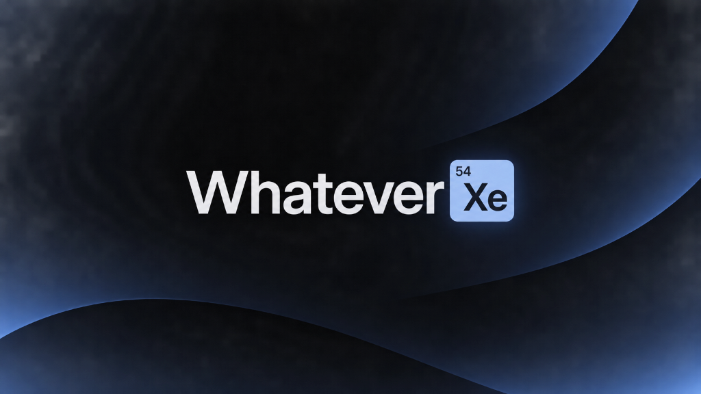

<p align="center">
  
</p>

<p align="center">
  <b>An experimental Lilu plugin adapting Apple graphics drivers for Intel Iris Xe Graphics (0xA7A0, 96 EU) on macOS Sequoia & Tahoe.</b>
</p>

<p align="center">
  <a href="https://github.com/akiffurkan/WhateverXe-0xA7A0/releases"></a>
  <a href="https://github.com/akiffurkan/WhateverXe-0xA7A0/actions"></a>
  
  
  
</p>

<p align="center">
  <a href="README_ja.md">🇯🇵 日本語 (Japanese Original README)</a> • <a href="#-quick-start">🚀 Quick Start</a> • <a href="#-compatibility--hardware">💻 Hardware</a> • <a href="#-opencore-configuration">⚙️ OpenCore Setup</a>
</p>

---

## 📌 About This Fork

This repository is an optimized fork of [b00t0x/WhateverXe](https://github.com/b00t0x/WhateverXe), specifically tuned and verified for **13th Gen Intel Core (Raptor Lake-P) Iris Xe Integrated Graphics (`0xA7A0`, 96 Execution Units)**.

Primary testbench hardware:
- **Laptop:** Huawei MateBook D 16 (2024)
- **CPU:** 13th Gen Intel® Core™ i9-13900H (14 Cores / 20 Threads)
- **iGPU:** Intel® Iris® Xe Graphics (`8086:A7A0`, Subsystem Revision `0x0004`, 96 EUs)
- **OS Support:** macOS Sequoia (15.x) & macOS Tahoe (26.x)

> [!WARNING]
> **Active Development Status:** Full 2D/3D hardware acceleration (Metal 3 & QE/CI) on Raptor Lake-P `0xA7A0` is currently under **active experimental testing**. Display pipe, backlight control, and framebuffer initialization are operational. Work on context publishing and Metal driver stabilization is ongoing.

---

## 💻 Compatibility & Hardware

| Family | Device ID | Subslice / EU | Test Hardware | Status |
| :--- | :---: | :---: | :--- | :---: |
| **Raptor Lake-P** | `0xA7A0` | 96 EU | Huawei MateBook D 16 (i9-13900H) | 🟡 In Active Development |
| **Raptor Lake-P** | `0xA7A1` | 96 EU | Generic RPL-P Laptops | 🟡 Experimental |
| **Raptor Lake-U** | `0xA7A9` | 48 EU | MiniBook X U300 | 🟢 Verified Upstream |
| **Alder Lake-H** | `0x46A6` / `0x4626` | 96 EU | Generic ADL-H Laptops | 🟢 Verified Upstream |
| **Alder Lake-N** | `0x46D0`–`0x46D4` | 16–32 EU | Alder Lake-N Mini PCs | 🟢 Verified Upstream |

---

## ⚙️ OpenCore Configuration

### 1. Kext Injection (`config.plist -> Kernel -> Add`)
Ensure the following kexts are loaded in strict order:
1. `Lilu.kext` (v1.7.2 or newer)
2. `AppleIntelTGLCompat.kext` (Provides the underlying compatibility layer)
3. `WhateverXe.kext` (This driver)
4. `AMFIPass.kext` (Must use the custom **AMFIPass 1.4.1 Mod**)

> [!IMPORTANT]
> `WhateverGreen.kext` **must be completely disabled** when `WhateverXe.kext` is active. Do not enable both simultaneously.

### 2. Boot Arguments (`NVRAM -> 7C436110-AB2A-4BBB-A880-FE41995C9F82 -> boot-args`)
Add the following required flags:
```text
-allow3d -disablegfxfirmware -igfxdvmt -vi2c-force-polling
```
- `-allow3d`: Enables 3D pipeline routing.
- `-disablegfxfirmware`: Disables firmware load checks.
- `-igfxdvmt`: Required if UEFI DVMT pre-allocated memory is locked at 60MB.
- `-vi2c-force-polling`: Prevents I2C trackpad interrupts from conflicting with GPU display timing.

### 3. SIP & Security (`csr-active-config`)
Set `csr-active-config` to `03080000` (`0x803`) to allow auxiliary kernel collection rebuilding.

### 4. DeviceProperties (`DeviceProperties -> Add -> PciRoot(0x0)/Pci(0x2,0x0)`)
```xml
<key>PciRoot(0x0)/Pci(0x2,0x0)</key>
<dict>
    <key>framebuffer-patch-enable</key>
    <data>AQAAAA==</data>
    <key>framebuffer-stolenmem</key>
    <data>AAAMAw==</data>
    <key>enable-backlight-registers</key>
    <data>AQAAAA==</data>
    <key>applbkl</key>
    <data>AQAAAA==</data>
    <key>applbkl-force-supported</key>
    <data>AQAAAA==</data>
    <key>enable-backlight-smoother</key>
    <data>AQAAAA==</data>
    <key>enable-cdclk-frequency-fix</key>
    <data>AQAAAA==</data>
</dict>
```

---

## 📦 WhateverXe Graphics Package

In macOS Sequoia and Tahoe, graphics acceleration relies on both the kernel driver and user-space Metal bundles:
1. Boot into macOS with WhateverXe injected in OpenCore.
2. Install the companion **`WhateverXe-Graphics-0.4.4.pkg`** (installs `/Library/GPUBundles/AppleIntelTGLGraphicsMTLDriver.bundle`).
3. Rebuild the auxiliary kernel collection:
   ```bash
   sudo chown -R root:wheel /Library/Extensions/AppleIntelTGL*
   sudo chmod -R 755 /Library/Extensions/AppleIntelTGL*
   sudo kmutil install --volume-root /
   ```
4. If prompted with *"System Extension Blocked"*, navigate to **System Settings > Privacy & Security** and click **Allow**, then reboot.

---

## 🛠️ Building From Source

```bash
git clone https://github.com/akiffurkan/WhateverXe-0xA7A0.git
cd WhateverXe-0xA7A0
python3 tools/build.py --release --output build/RELEASE
```

Automated artifacts are also compiled on every commit via GitHub Actions.

---

## 🤝 Credits & Acknowledgments

- **[b00t0x](https://github.com/b00t0x)** — For the revolutionary WhateverXe project and reverse-engineering Apple's Xe driver stack.
- **[Acidanthera](https://github.com/acidanthera)** — For Lilu, WhateverGreen, and the gold-standard Hackintosh kernel extension ecosystem.
- **[Akif Furkan Emir](https://github.com/akiffurkan)** — Fork maintenance, Raptor Lake-P `0xA7A0` testbench, and documentation.
